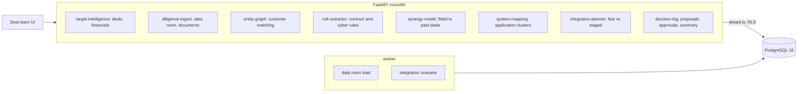

# M&A Intelligence and Integration

For a corporate development team buying a company: it reads the data room for the clauses and findings that could break the deal,
matches the two companies' customers into one entity graph, turns management's synergy case into distributions with a model fitted
to a database of past deals, finds the overlapping applications, compares a fast and a staged ERP integration against the premium being
paid, records the decision with a second approver, and tracks the synergies quarter by quarter after close.

Built from blueprint 20 of "Advanced Engineering Build Book, Volume IV" as a **vertical slice**: the demo scenario end to end, with
the platform parts real and the rest listed under [Not built](#not-built-and-why).

**The acquirer, the target, both customer masters, the contracts, the cyber assessment, both application portfolios, the database of
past deals and the true process behind it are generated by a simulator in this repository. Nothing is a real company, deal or
vulnerability. The models never see the truth; it is shown beside every result only to score them. The document "extraction" is
hand-written rules, and the executive summary is filled-in templates: there is no language model anywhere.**

## Run it

```bash
docker compose up --build        # migrates, seeds, serves http://localhost:8420/ui/ with one worker
docker compose run --rm test     # 11 tests against a throwaway database
```

Open http://localhost:8420/ui/ and press **Run all steps** (about 3 seconds), or `make bootstrap demo`.
Demo tokens (local only): `aldermoor-deal_lead-demo`, `aldermoor-analyst-demo`, `aldermoor-viewer-demo`. Run `make reset` before a second demo run.

## The demo, step by step

1. **A target and its data room.** Aldermoor Group ($2.4B revenue) is buying Corvane Systems for $1.2B against a standalone value of
   $940M: a $260M premium the synergies have to pay for. Management's case is $30M a year of cost synergies and $45M of extra revenue,
   with one fast ERP cutover. The data room loads in a background job: twelve quarters of financials ($310M revenue, 13.9% EBITDA),
   420 customers on the target's side and 2,600 on the acquirer's, the forty largest customer contracts, a cyber assessment, 40
   applications, and 240 past deals. Three more documents arrive one by one: a side letter with a change-of-control exit ($46.7M of
   revenue) is caught; an amendment that gives the same exit in other words ("more than half of the voting securities") is not, and the
   page says so; a letter for a customer the target does not have is refused.
2. **What could break the deal.** The largest customer is 15.1% of revenue. Fourteen customers, 37% of revenue, can leave on a change of
   control (the rules found 14 of the 16 such contracts, no false alarms, and miss one wording every time). Twelve contracts are
   terminable for convenience. Three critical or high cyber findings are open, two internet-facing. The matcher links 139 customers
   across the two masters: 48% of the target's revenue comes from customers the acquirer already serves (exact names find 8%; the truth is 46%).
3. **Synergies as distributions.** Fitted to the 240 past deals, including the 53 still ramping and the 53 that went quiet after their
   first year: staged integration gives $26.3M of cost synergies (80%: $19.9–34.6M) and $15.8M of revenue synergies ($8.7–29.0M);
   fast gives $12.5M of revenue synergies. Management's case says 1.0× of both; the bankers' comparables 0.93× and 0.60×; the model
   0.88× and 0.35× (staged); the truth 0.90× and 0.44×. ERP programmes run 1.27× their plan (truth 1.35×); a fast cutover goes wrong 31%
   of the time (truth 35%).
4. **Two application estates.** Clustering on functional tags finds 12 overlapping capabilities and $9.0M a year of systems to retire,
   against $10.5M in the case; against the truth it finds 81% of the overlapping pairs with no false ones, where product names find
   71%. The target's ERP carries 8 interfaces, each a workstream.
5. **Fast or staged ERP.** Two interface teams is the best size for both. Fast: planned 38 weeks, P50 48, P90 68, a 30% chance the
   cutover goes wrong, expected value $268M (80%: $194–350M), 51% chance of covering the premium. Staged: planned 62 weeks, P50 78, P90
   111, $263M, 48%. The plans as written say $397M and $389M. In the truth both are worth $282M and cover the premium 57–58% of the time.
   A close call, and the page says so.
6. **Decide, approve, then track.** The analyst proposes fast; their own approval is refused; the deal lead approves. Four quarters of
   reports: cost synergies forecast at $29.6M ($28.0–31.3M, truth $32.4M, outside the band), revenue at $16.6M ($15.8–17.5M, truth
   $17.3M); the straight line from the fourth quarter says $34.8M and $10.1M. Revenue at 37% of the case opens a review task. The
   executive summary cites the rows behind every sentence. The audit log is a hash chain.

## Architecture



| Piece | How it works |
|---|---|
| Simulator (`ma/world.py`) | A target with twelve quarters of financials; 420 customers with a heavy tail; the acquirer's 2,600-customer master holding 30% of them in its own spellings (case, suffix, abbreviation, typo, a leading "The", "&"/"and") plus sister companies with the same name and another legal suffix; forty contracts from five change-of-control and three convenience wordings among boilerplate; a twelve-finding cyber report; two application portfolios with noisy functional tags; 240 past deals whose realised synergies come from a true log-linear process with two kinks the model does not know, disclosed at the first anniversary and at the latest date unless the deal fell behind and went quiet; ERP programmes with lognormal lateness, some still running. |
| Entity graph | Names normalised (case, punctuation, legal suffix, common abbreviations, "The"), matched exactly, else to the most similar name sharing the first word at similarity ≥ 0.9 (`difflib`). Baseline: exact names. |
| Risk extractor | Sentence rules for change of control and convenience; one regular expression per cyber finding; concentration from the customer master. Every risk is stored with the document, clause and sentence it came from. |
| Synergy model | log(reported / announced) = features · β + k·log(months/36) + a deal effect + reporting noise, by maximum likelihood (GLS profiled over the two variances) on every first-anniversary and latest report. Predictive draws add coefficient uncertainty. Baselines: management's case, bankers' comparables (deals three years on that still disclose), latest disclosure as final. |
| ERP model | Lateness lognormal by right-censored maximum likelihood; cutover incidents Beta(1, 1) updated by finished programmes; disruption weeks lognormal. |
| System mapping | Jaccard distance on tags, average linkage cut at 0.75 (`scipy`); cross-company clusters are overlaps, the target's system retired. |
| Integration planner | Workstreams from the target ERP's interfaces; critical path by topological order (`graphlib`); interface rebuilds packed into teams (longest first); staged repeats migration, testing, training and cutover for two more entities at reduced effort. Team size by enumeration. 10,000 draws of lateness, incidents and synergies through five years of weekly value plus nine times run-rate, against the premium. |
| Tracker | A normal update of the deal's log realisation from quarterly reports, each divided by the fitted ramp, with the ramp's shared error in the covariance. A likely shortfall opens a review task. |
| Platform | Row-level security per tenant, Postgres job queue, Idempotency-Key replay, hash-chained audit log, four-eyes approval, `/metrics`. |

## Data model

`migrations/002_ma.sql` follows the blueprint (deal, company, financial_metric, document, risk, synergy, system, dependency,
integration_workstream, milestone, decision, evidence, model_artifact); additions are marked `(+)`: deal terms and the management case,
entity_edge, comparable_deal, integration_scenario, realisation_report.

## API

| Method | Endpoint | Purpose |
|---|---|---|
| POST | `/v1/deals` | Open a deal; refused if the price is not above standalone value |
| POST | `/v1/diligence/import` | 202 + job: the synthetic data room; or documents one by one, parsed on arrival |
| GET | `/v1/deals/{id}` | (+) Financials, counts, terms |
| GET | `/v1/deals/{id}/risks` | Risks with their evidence; entity graph; how the rules did |
| POST | `/v1/synergies/model` | Fit both models, store them versioned, synergies as distributions |
| GET | `/v1/systems/dependencies` | Applications, overlaps, savings, the target ERP's interfaces |
| POST | `/v1/integration/scenario` | 202 + job: fast against staged |
| POST | `/v1/decisions` · `/v1/decisions/{id}/approve` | Propose with evidence and policy checks; approve (never your own) |
| POST | `/v1/synergies/track` | (+) Quarterly reports into an updated forecast; shortfall opens a review task |
| GET | `/v1/deals/{id}/summary` | (+) Executive summary, every sentence citing its rows |

Contract: [`docs/openapi.json`](docs/openapi.json).

## Measured

[`docs/evaluation.md`](docs/evaluation.md) (`python -m ma.evaluate`, five data rooms and deal databases the demo never uses, 12 s) and
[`docs/performance.md`](docs/performance.md).

| Component | Result | Baseline |
|---|---|---|
| Synergy realisation, median error on 2,000 fresh deals, cost | 0.13–0.14 of the case | management 0.18–0.19; comparables 0.17–0.19 |
| Same, revenue | 0.16 | management 0.51–0.53; comparables 0.22–0.28; latest as final 0.17–0.18 |
| Model's 80% interval covers | 75–83% | |
| ERP lateness | ×1.31–1.40 | truth ×1.35 |
| Fast against staged | same choice as the truth on 2 of 5 | the truth's own gap is $0–8M |
| Plan as written | | $77–110M above the truth |
| Tracker after four quarters, median error | 0.02–0.05 cost, 0.01–0.02 revenue | straight line 0.17–0.23; no reports 0.12–0.17 |
| Tracker 80% band covers | cost 49–81%, revenue 74–88% | |
| Customer matching, precision / recall | 0.86–0.91 / 1.00 (circular) | exact names 1.00 / 0.18–0.30 |
| Change-of-control rules | 59 of 74 clauses, no false alarms; one wording 0 of 15 | |
| Application clusters, recall | 0.80–1.00 at precision 1.00 | product names 0.28–0.58 |

Three things these numbers say plainly. The model cannot tell fast from staged better than a coin, because the truth barely can either:
the choice is worth a few million dollars against a range of $180–200M, and what the model does show is that the plan as written is
about $100M too high whichever is chosen. The tracker's cost bands are too narrow on two of five databases (49% and 68% coverage): the
fitted cost ramp comes out a few hundredths steep, because deals going quiet are not quite missing at random once revenue figures are
missing too, and early reports magnify that. And the matching, the rules and the clusters are circular: written by the same hand as the
generator's spellings, wordings and tags, so their recall is an upper bound; the precision lost to sister companies and the one wording the
rules never catch are the honest part.

## The hardest tradeoff

Which history to believe. The deal database is full of deals that are not finished: a fifth are still ramping, and more than a quarter of the
older ones stopped disclosing after their first year, mostly because they were behind. Banks quote the deals that finished and kept
reporting, which runs high; taking every latest number as final runs low. Dropping either group biases the answer, so the model keeps
every deal at every point it reported, with the ramp and the deal's own surprise estimated together. It is not free: it assumes the
ramp has the generator's shape, and the quiet deals still leave a small bias that shows up in the tracker's cost bands.

## Threat model (summary)

| Threat | Mitigation here | Gap |
|---|---|---|
| A clause the rules do not recognise | Recall measured per wording against the truth and the miss shown on the page; the exposure stated as a floor | A real data room needs a lawyer's read or a trained model |
| One customer counted as two, or two as one | Same-as edges carry their method and similarity; exact-name baseline beside them | Sister companies are linked wrongly |
| A decision taken on a stale or private model | The decision stores the scenario's hash and the model versions; approval needs a second person and the deal lead's role | No re-check when the data room changes |
| Another firm seeing this deal | Row-level security on every table; tested through the API and in the database | |

## Not built, and why

- **A language model for extraction and the summary**: rules and templates are checkable against the generator; a model on synthetic text would score itself.
- **OCR, PDF parsing, virtual data room connectors**: documents arrive as text.
- **Neo4j, OpenSearch, pgvector**: the entity graph is two tables; matching is by name.
- **Revenue dis-synergy from change-of-control exits**: the exposure is reported, not simulated into the value.
- **Org charts, retention, key-person risk, litigation**: outside the demo's question.
- **Kafka, Temporal, Kubernetes, Next.js, SSO**: not needed to prove the slice; no cloud account used.

## Commercial sketch

Buyer: corporate development teams, private equity firms, investment banks, integration consultancies. Pricing shape from the
blueprint: per deal or per seat, with the deal database as a licensed add-on.

## Layout

```
core/        platform kit: db + RLS, jobs, audit chain, HTTP, scenario runner, load test
ma/          world (deal, data room, deal database, truth), engine (matching, rules, clusters, fits, plan, value, tracker), api, seed, evaluate
migrations/  forward-only SQL          web/   UI, scenario.json, demo.json (recorded run)
tests/       11 tests                  docs/  evaluation.md, performance.md, openapi.json
```
